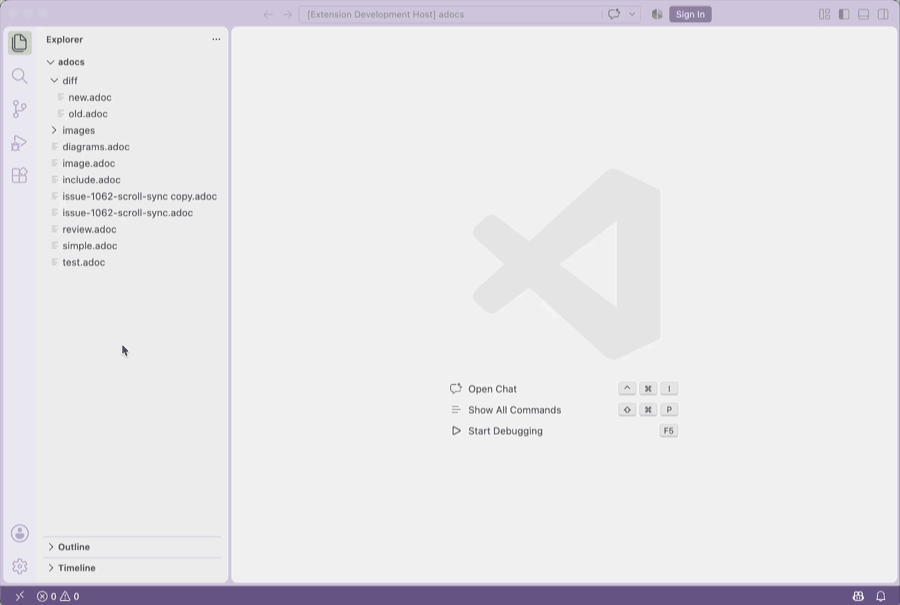

# AsciiDoc Diff for VS Code

Форк расширения [AsciiDoc для Visual Studio Code](https://github.com/asciidoctor/asciidoctor-vscode).

Добавляет **сравнение отрендеренного вывода двух AsciiDoc-файлов** в одной
панели: слева — старый вариант, справа — новый.

## Что добавлено

- Сравнение двух файлов по **отрендеренному HTML**, а не по исходному тексту:
  - пословная подсветка изменений;
  - подсветка добавленных и удалённых блоков;
  - подсветка изменений в таблицах (таблица, ячейки, слова).
- Синхронная прокрутка обеих панелей.
- Кнопка **Swap** в шапке для смены файлов местами.
- Выбор файлов через контекстное меню Explorer:
  - **AsciiDoc → Select for Comparison** — отметить первый файл (рядом появляется
    значок `⇄`, имя видно в статус-баре);
  - **AsciiDoc → Compare** — сравнить с отмеченным файлом;
  - **AsciiDoc → Clear Comparison Selection** — снять выбор.
- Живое обновление сравнения при редактировании и сохранении файлов.
- В обеих панелях работают картинки, MathJax, Mermaid, PlantUML и стили из
  настроек preview.
